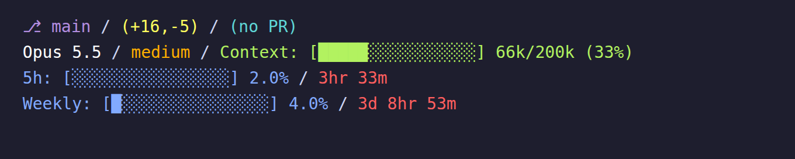

# ccstatusline config

My [ccstatusline](https://github.com/sirmalloc/ccstatusline) setup for the Claude Code status line.



## Prompts
Paste one of these into Claude Code.

### Install
Installs ccstatusline and applies this config.

```text
Set up my Claude Code status line with ccstatusline (https://github.com/sirmalloc/ccstatusline) using the config from https://github.com/adithya-s-edstem/ccstatusline-config. Steps:

1. Install ccstatusline globally: npm i -g ccstatusline@latest (use bun if npm isn't available). Confirm the `ccstatusline` command is on PATH.
2. If ~/.config/ccstatusline/settings.json exists, back it up to settings.json.bak-<today's date> in the same folder before changing anything.
3. Download https://raw.githubusercontent.com/adithya-s-edstem/ccstatusline-config/main/ccstatusline-config.json and save it as ~/.config/ccstatusline/settings.json (create the folder if needed; on Windows this is %USERPROFILE%\.config\ccstatusline\settings.json).
4. In ~/.claude/settings.json, set "statusLine" to {"type": "command", "command": "ccstatusline", "padding": 0}. Keep every other setting as is, and show me the old statusLine value if one existed.
5. Verify: pipe sample input into it, e.g. echo '{"model":{"display_name":"Opus"},"cwd":"."}' | ccstatusline, and show me the output. It should print git, model and effort, session usage and weekly usage lines.
6. Tell me where the backup is and that the new status line appears on the next refresh.
```

### Update
Updates ccstatusline, explains what changed, and suggests config changes. It doesn't change your config until you agree.

```text
Update my ccstatusline (https://github.com/sirmalloc/ccstatusline) Claude Code status line and tell me what's new. Steps:

1. Note the installed version (npm ls -g ccstatusline, or ccstatusline --version) and the latest on npm (npm view ccstatusline version). If they match, say I'm up to date and stop.
2. Install the latest: npm i -g ccstatusline@latest (or bun if that's how it was installed). Confirm the new version.
3. Read the release notes for every version between the old and new one (gh release view <tag> -R sirmalloc/ccstatusline, or https://github.com/sirmalloc/ccstatusline/releases). Summarize the user-facing changes, grouped as new widgets, changes to existing widgets, TUI changes and fixes. Skip dependency bumps, tests and docs.
4. Render my config with sample input that includes context data, e.g. echo '{"model":{"display_name":"Opus"},"cwd":".","context_window":{"context_window_size":200000,"used_percentage":33}}' | ccstatusline, and show me the output. Point out anything that looks different from before (renamed labels, changed numbers) and which release caused it.
5. Read ~/.config/ccstatusline/settings.json. If "installation.installedVersion" is out of date, update it (back the file up first to settings.json.bak-<today's date>).
6. Suggest specific changes to my config based on the new features: which widgets or options fit my current lines and why. Don't apply any of them until I say which ones I want.
```

## Layout
```
 ⎇ main / (+0,-0) / (no PR)
 Opus 5.5 / medium / Context: [context bar] 66k/200k (33%)
 5h: [░░░░░░░░░░░░░░░░] 2.0% / 2h 10m
 Weekly: [░░░░░░░░░░░░░░░░] 0.0% / 5d 8hr 30m
```

| Line | Widgets | Colors |
|---|---|---|
| 1 | git branch, git changes, PR review | magenta, yellow, cyan |
| 2 | model, thinking effort, context bar | white, orange, green |
| 3 | 5-hour block usage, 5-hour reset timer | blue, red |
| 4 | weekly usage, weekly reset timer | blue, red |

Usage meters share blue and reset timers share red. Labels are kept only where a value would be ambiguous (branch icon, Context, 5h, Weekly); everything else shows its raw value.

## Save changes back to the repo
After editing in the TUI (`ccstatusline`), copy the live config back here so the repo stays current:
```bash
cp ~/.config/ccstatusline/settings.json ccstatusline-config.json
```
